# Argus

Argus is a local log-analysis container for a Mac running Apple's `container` runtime. It reads the Mac's own logs read-only and can also act as a syslog / syslog-ng target for other devices. Everything it collects runs through CrowdSec, a set of threat feeds and OSINT lookups (including your local IntelOwl), and the results appear in a dashboard at <http://127.0.0.1:7080>.

It only detects. No bouncer is installed and nothing is blocked on the Mac.

## How it fits together

```mermaid
flowchart TB
  subgraph HOST["macOS host"]
    LD["<b>LaunchDaemon</b><br/>root · every 5 min<br/>unified-log security slice"]
    LA["<b>LaunchAgent</b><br/>you · every 15 min<br/>containers, launchd, Ollama"]
    INBOX[("/Users/Shared/Argus/inbox<br/>root-owned")]
    LOGS[("/var/log · /Library/Logs<br/>~/Library/Logs")]
    LD --> INBOX
    LA --> INBOX
  end

  subgraph NET["Your network"]
    REMOTE["Routers · NAS<br/>other hosts"]
    PIHOLE["Pi-hole v6 API"]
  end

  subgraph ARGUS["argus container · one VM"]
    SYSLOG["<b>syslog-ng</b><br/>UDP 5514 · TCP 5515"]
    SVC["<b>Argus service</b> · :7080<br/>findings · posture · timeline"]
    CS["<b>CrowdSec</b><br/>detect only · no bouncer"]
    ENRICH["<b>Enrichment</b> · IPs, domains<br/>threat feeds · CrowdSec list<br/>RDAP · Shodan · CTI · VT"]
  end

  DATA[("$ARGUS_HOME/data<br/>only writable folder")]
  INTELOWL["IntelOwl API"]

  INBOX -- "read-only" --> SVC
  LOGS -- "read-only" --> SVC
  PIHOLE -- "query log · 2 min" --> SVC
  REMOTE -- "syslog" --> SYSLOG
  SYSLOG -- "remote.tsv" --> SVC
  SYSLOG -- "per-host logs" --> CS
  SVC -- "events" --> CS
  SVC --> ENRICH
  ENRICH <-- "flagged" --> INTELOWL
  SVC -- "reports" --> DATA

  style HOST fill:transparent,stroke:#8b949e,stroke-dasharray:4 3
  style NET fill:transparent,stroke:#8b949e,stroke-dasharray:4 3
  style ARGUS fill:transparent,stroke:#2f81f7,stroke-width:2px
```



### Why there is a host collector

The unified log is a binary store that only macOS's own `log` tool can read; a Linux container cannot parse it. A small root job therefore exports a filtered slice every five minutes using `log show --start/--end` windows, so nothing is missed or duplicated across runs. Everything else (crash reports, `/var/log`, `~/Library/Logs`) is mounted into the container read-only.

## What the container can and cannot touch

| Access | Paths |
|---|---|
| Read-only | collector inbox, `/private/var/log`, `/Library/Logs`, `~/Library/Logs` |
| Read-write on the Mac | `$ARGUS_HOME/data` only (reports, CSV exports, optional `config/feeds.json`) |
| Its own storage | named volumes `argus-state`, `argus-cs-config`, `argus-cs-data` (inside the VM, not your file system) |
| Root file system | read-only (`ARGUS_READONLY_ROOT=1`); tmpfs for `/tmp`, `/run`, `/var/log` |
| Network in | dashboard on `127.0.0.1:7080`; syslog on `127.0.0.1` unless you choose a LAN address |
| Capabilities | `NET_RAW`, `MKNOD`, `SYS_CHROOT`, `AUDIT_WRITE` and `SETFCAP` dropped |

The collector is installed root-owned at `/usr/local/libexec/argus/`. A root LaunchDaemon must never run a script your account can edit.

## Prerequisites

- A Mac with [Apple's `container` CLI](https://github.com/apple/container) installed and working (`container --version`).
- Admin/sudo access, for the host collector's root `LaunchDaemon`.
- Nothing else is required to start — every integration (Pi-hole, IntelOwl, CrowdSec enrollment, OSINT keys) is optional and off until you configure it.

## Setup

```bash
git clone <this repo> && cd argus
./argus.sh init                 # creates $ARGUS_HOME (default ~/.argus), config, CrowdSec bouncer key
# edit $ARGUS_HOME/config/argus.env  (Pi-hole app password, IntelOwl token, optional keys — see argus.env.example)
./argus.sh build                # builds argus:latest (CrowdSec Alpine image + Node 24 + syslog-ng)
./argus.sh install-collector    # sudo: LaunchDaemon + your LaunchAgent, root-owned inbox
./argus.sh up                   # starts the container, prints the dashboard URL
```

Open <http://127.0.0.1:7080>. Everything below is optional configuration — Argus runs with none of it set.

`$ARGUS_HOME` defaults to `~/.argus` and holds config and reports; set your own path to put it somewhere else. The config file holds secrets and is `chmod 600` by `init`. **Keep `ARGUS_HOME` lowercase if you override it** — on the default case-insensitive Mac file system, a differently-cased path you choose yourself can silently collide with another directory and leave you editing the wrong `argus.env` without any error (`argus.sh` warns about this where the default is set, but a custom path isn't checked for you).

Paths in the rest of this README (`$ARGUS_HOME`, `/Users/Shared/Argus/inbox`, etc.) are the defaults from `argus.env.example` — every one of them is a setting, not a requirement; change any of them in `argus.env` to fit your own layout.

**Pi-hole.** Leave `PIHOLE_URL` blank and `argus.sh up` finds a running container whose name contains `pihole` on the default network. Set `PIHOLE_PASSWORD` to an app password (Settings → Web interface / API).

**IntelOwl.** Apple `container` networks are isolated from each other, so Argus can only reach IntelOwl if both are on the same named network — put IntelOwl's containers on the same network Argus uses (`default` unless you've changed it) and set `INTELOWL_URL` to `intelowl-nginx`'s address on that network (`container inspect intelowl-nginx` to find it). Leave `INTELOWL_URL` blank to leave IntelOwl enrichment off. Paste an API token into `INTELOWL_TOKEN`. Flagged indicators run the `FREE_TO_USE_ANALYZERS` playbook, capped at 50 per day, and every job links back to `http://localhost:7001`.

**Syslog from other devices.** Set `ARGUS_SYSLOG_BIND` to the Mac's LAN IP, run `./argus.sh restart`, then point devices at `<mac-ip>:5514/udp` or `:5515/tcp`. Use RFC 3164 (BSD) format, one message per line. `./argus.sh syslog-test` sends a test line.

### Send this Mac's own logs as syslog

```bash
./argus.sh stream on      # stream off | stream status
```

This sets up two paths:

1. **Live unified log.** A root LaunchDaemon (`com.argus.logstream`) runs `log stream`, rewrites each line as RFC 3164 syslog and sends it over TCP to the listener. CrowdSec then sees SSH and sudo failures within seconds instead of on the next 5-minute batch. `ARGUS_STREAM_MODE=slice` (default) sends the security events only. `all` sends the whole default-level log, which is hundreds of events per second; use it only for short investigations.
2. **Legacy syslogd.** One line `*.* @127.0.0.1:5514` is appended to `/etc/syslog.conf` (backup kept), and `syslogd` reloads. On current macOS this is only the small stream you see in `/var/log/system.log` and `install.log`; everything else lives in the unified log, which path 1 covers.

`stream on` also sets `ARGUS_MACOS_TO_CROWDSEC=0` and restarts Argus, so CrowdSec doesn't count the same event twice. The 5-minute collector keeps running and still feeds the dashboard's macOS views. `stream off` undoes all of it.

### Day to day

```bash
./argus.sh status | logs | shell | open
./argus.sh cscli alerts list    # anything cscli can do
./argus.sh restart              # after editing argus.env
./argus.sh destroy              # remove container + volumes, keep config and reports
```

## Threat intelligence

Every public IP and domain Argus sees becomes an **indicator**. Indicators come from active connections, Pi-hole queries, SSH, Screen Sharing and firewall events, syslog messages, and your manual lookups. Each one is matched against feeds and CrowdSec immediately. OSINT providers then work through a priority queue:

| Priority | Indicators | Automatic enrichment |
|---|---|---|
| 3 | feed hit, CrowdSec match, anything already flagged, manual lookups | all providers incl. VirusTotal, CrowdSec CTI, IntelOwl |
| 2 | SSH / Screen Sharing / firewall sources, DNS names that look generated or tunnelled | + DNS resolution, ThreatFox |
| 1 | public IPs in active connections, IPs in syslog | Shodan InternetDB, AbuseIPDB, OTX, URLhaus, GreyNoise |
| 0 | every other domain Pi-hole sees | RDAP registration date (newly registered domains are flagged) |

| Feed | Key | Notes |
|---|---|---|
| HaGeZi Threat Intelligence (medium) | none | ~885k malware/phishing/C2 domains, parent-domain matching |
| FireHOL Level 1, IPsum (≥3 lists) | none | from GitHub |
| Spamhaus DROP, Emerging Threats, CINS, blocklist.de, OpenPhish | none | |
| abuse.ch Feodo, URLhaus, ThreatFox | free Auth-Key | abuse.ch now requires a key; get one at auth.abuse.ch |
| CrowdSec community blocklist | none | read from the local API via the `argus` bouncer key |

Optional keys (`argus.env`): `ABUSECH_AUTH_KEY`, `CROWDSEC_CTI_KEY`, `ABUSEIPDB_KEY`, `VT_API_KEY`, `OTX_API_KEY`, `GREYNOISE_KEY`. Providers without a key stay off, and daily caps keep free tiers safe. Extra feeds can go in `$ARGUS_HOME/data/config/feeds.json`:

```json
[{"id": "my_list", "name": "My blocklist", "kind": "domain", "format": "wildcard", "severity": "high",
  "url": "https://example.org/list.txt", "ttlHours": 12}]
```

Formats: `plain` (IPs, CIDRs or domains, one per line), `wildcard` (domains that also match subdomains), `url` (URLs, matched by exact host), `ipsum`, `spamhaus-json`.

## What the macOS analysis covers

- **Access:** sudo commands and failures, including flagged ones like quarantine removal, Gatekeeper exceptions and new admin users. Also SSH and Screen Sharing logins, admin-prompt failures, login history and screen lock/unlock.
- **Permissions:** which apps use Full Disk Access, Accessibility, Screen Recording, Input Monitoring, camera and microphone (from TCC decisions).
- **Gatekeeper / XProtect:** blocked launches, first-launch prompts for unsigned apps, and XProtect detections.
- **Persistence:** launch agents and daemons with anomaly flags (temp or hidden paths, inline `curl | sh`, fake `com.apple` labels, world-writable plists). Also background items without a Team ID, system extensions, profiles, crontab and failing agents.
- **Network:** services listening beyond localhost, and public endpoints the Mac is talking to.
- **Posture:** SIP, Gatekeeper, FileVault, firewall and stealth mode, Remote Login, automatic updates, XProtect definition age.
- **System:** crash and panic reports, memory-pressure kills, fault-heavy processes, sleep/wake, install history, Apple container log errors, Ollama API exposure.

Reports are written every 5 minutes to `$ARGUS_HOME/data/reports/`: `latest.json`, `findings.csv`, `indicators.csv`, and one JSON file per day.

## Log throughput

**Short answer:** a Mac playing YouTube in Safari writes on the order of hundreds of unified-log entries per second. Argus ships only the security slice, which is usually well under one event per second.

| Stream | Typical rate | Volume / day |
|---|---|---|
| Full unified log, default level, Safari + YouTube (estimate) | ~100–500 events/s, bursts of thousands | ~6–43 GB as ndjson (0.65–1 KB/event); ~1.5–9 GB as compact text |
| Same with `--info` | several times higher | not worth shipping |
| **Argus security slice** (auth, sudo, SSH, TCC, Gatekeeper, XProtect, firewall, login items, faults) | ~0.05–1 events/s | ~3–55 MB ndjson; the CrowdSec copy is ~1/6 of that |
| Pi-hole queries from a YouTube session | a few hundred per hour | < 1 MB |
| Home router syslog (firewall logging on) | 1–20 messages/s | ~10–250 MB |

These are estimates, anchored on published measurements. Howard Oakley counted about 6,100 entries per second written to disk during a short burst of activity, plus about 1,700 per second kept only in memory. The on-disk Persist store is capped around 525 MB, which on a busy Mac covers anywhere from under 12 hours to about 5 days. Video playback keeps WebKit's GPU and media processes, CoreMedia, coreaudiod, the network stack and WindowServer busy, but most of what they log is info/debug-level noise with no security value. That is why Argus filters at the source.

Measure your own Mac while a video plays (each command reads the last 10 minutes):

```bash
log show --last 10m --style ndjson | wc -lc                       # full default level
log show --last 10m --info --style ndjson | wc -lc                # with info
sudo /usr/local/libexec/argus/argus-collect.sh system && \
  wc -lc /Users/Shared/Argus/inbox/unified/*/* | tail -1          # Argus slice so far
```

Divide lines by 600 to get events per second. The dashboard's **Throughput** tab shows the live per-input rates and a projected daily volume. CrowdSec processes thousands of lines per second, so it is never the bottleneck at these rates.

## Known limits

- **CrowdSec takes a moment to come up.** The bundled CrowdSec daemon runs its own hub update and CAPI registration before its Local API starts listening — right after `argus.sh up` (or `restart`), the dashboard's CrowdSec tab can briefly show a fetch error (`connect: connection refused`) while that finishes. It clears on its own within a poll cycle or two; if it doesn't, `argus.sh logs | grep -iE 'crowdsec|capi|hub update'` shows what it's stuck on.
- **Env values aren't shell-quoted.** `argus.env` is read as flat `KEY=value` (the same way Docker's `--env-file` works, no shell involved), so wrapping a value in `"like this"` passes the quote characters through literally instead of stripping them — a password or key copied in that way will fail silently. Leave values bare.
- **Syslog on a LAN address.** Apple's documentation only shows publishing ports on loopback. If binding the syslog port to your LAN IP is refused, keep `127.0.0.1` and relay from another host.
- **Build-time DNS.** If `container build` fails with `DNS: transient error` or apk reports "no such package", the builder VM cannot resolve names, which is common when the Mac's DNS is a local Pi-hole. `./argus.sh build` notices this, recreates the builder with `ARGUS_BUILD_DNS` (default `1.1.1.1 9.9.9.9`) and retries. `./argus.sh builder-reset` does the reset on its own. If feeds fail to download at runtime for the same reason, set `ARGUS_DNS`.
- **Read-only root file system.** If CrowdSec's start script writes somewhere unexpected, set `ARGUS_READONLY_ROOT=0` and run `./argus.sh restart`.
- **CrowdSec ignores private IPs by default.** Brute force from your own LAN (for example on café Wi-Fi) won't raise a CrowdSec alert, but Argus's own SSH and Screen Sharing findings still flag it.
- **Root-only files.** Crash reports and logs readable only by root reach the container through the collector, not the read-only mounts.
- **`./argus.sh host-access`.** This (`host.container.internal`) is only needed for services published on the Mac's `127.0.0.1`. It turns off iCloud Private Relay and does not survive a reboot.

## Security

See [SECURITY.md](SECURITY.md) for the trust model: what the container can
and can't touch, exactly what indicator data leaves the Mac and to which
providers, secrets handling, and supply-chain notes. `sbom.json` at the repo
root is a CycloneDX bill of materials covering the npm dependencies, Docker
base images, Alpine packages, and CDN-loaded dashboard libraries — see
[docs/sbom.md](docs/sbom.md) for a plain-Markdown summary of the same data.

## Layout

```
argus.sh                  manager (build, up/down, collector install)
argus.env.example         settings template
SECURITY.md               trust model, data flows, secrets, supply chain
sbom.json                 CycloneDX software bill of materials
collector/argus-collect.sh  host collector (system / user / once)
collector/argus-logstream.sh  live unified-log → syslog relay (argus.sh stream on)
image/Dockerfile          crowdsecurity/crowdsec (Alpine) + Node 24 + syslog-ng
image/entrypoint.sh       supervises syslog-ng, CrowdSec, Argus
image/syslog-ng.conf      UDP 5514 / TCP 5515 → CrowdSec files + Argus spool
image/acquis-argus.yaml   CrowdSec acquisition
app/server.js             service + API
app/lib/engine.js         macOS log analyzer (also runs in a browser)
app/lib/intel.js          indicators, scoring, OSINT providers
app/lib/feeds.js          threat feeds
app/lib/crowdsec.js       decisions stream + alerts
app/lib/ingest.js         inbox, syslog spool, Pi-hole
app/public/index.html     dashboard (Tabler, Alpine.js, Chart.js, PapaParse)
```

## References

- Apple `container`: [command reference](https://github.com/apple/container/blob/main/docs/command-reference.md), [networking](https://github.com/apple/container/blob/main/docs/networking.md), [volumes](https://github.com/apple/container/blob/main/docs/volumes.md), [host integration](https://github.com/apple/container/blob/main/docs/host-integration.md)
- [CrowdSec Docker image](https://hub.docker.com/r/crowdsecurity/crowdsec)
- [Pi-hole FTL API spec](https://github.com/pi-hole/FTL/tree/master/src/api/docs/content/specs)
- [pyintelowl (IntelOwl API)](https://pypi.org/project/pyintelowl/)
- [abuse.ch ThreatFox export / Auth-Key](https://threatfox.abuse.ch/export/)
- Howard Oakley: [Inside the Unified Log 3: log storage and attrition](https://eclecticlight.co/2025/09/29/inside-the-unified-log-3-log-storage-and-attrition/), [How long does the log keep entries?](https://eclecticlight.co/2026/03/12/how-long-does-the-log-keep-entries/)
