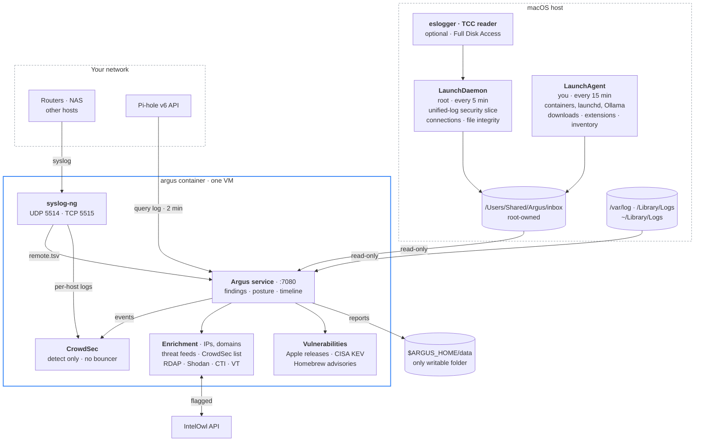
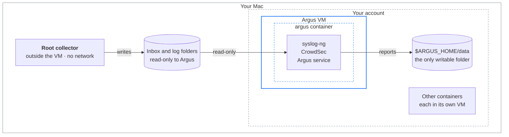

# Argus
Argus is a local log-analysis container for Macs running Apple's `container` runtime. Claude acted as the development agent, with human analysis driving the need. 

It reads the Mac's own logs (read-only), can take syslog from other devices on your network, and checks everything it collects against CrowdSec, a set of public threat feeds and OSINT lookups, including your own IntelOwl if you run one. 

The results show up in a dashboard at <http://127.0.0.1:7080>.

Argus only **watches**. It doesn't install a bouncer, and it never blocks anything on the Mac.

To get it running, see [Install](#install) for the short version or [docs/INSTALL.md](docs/INSTALL.md) for the full guide.

## What this gives you

One dashboard that answers the questions you'd otherwise dig through `log show` for: who ran sudo, which apps can see your screen, what starts at login, and who your Mac is talking to. Specifically:

- A list of findings ranked by severity, covering things worth a second look like a launch agent running from a temp folder, a first-launch prompt for an unsigned app, failed SSH logins or a new admin account.
- A quick read on your security posture: SIP, FileVault, firewall, Gatekeeper, automatic updates, and how out of date XProtect is.
- Reputation checks on the IPs and domains your Mac and your network actually touch, against threat feeds, CrowdSec and OSINT, with newly registered domains from Pi-hole called out.
- An Endpoint view of what's actually running: suspicious command lines and programs launched from odd places (via Apple's Endpoint Security), which program talks to which address (with Little Snitch if you have it), new background items, permission grants, browser extensions, trusted certificates, and changes to SSH keys, sudoers and shell startup files.
- A Vulnerabilities view: whether macOS and Safari are missing security releases, which installed apps predate fixes for vulnerabilities CISA lists as exploited in the wild, and Homebrew packages with published advisories.
- Syslog from your routers, NAS boxes and other hosts in the same place, run through CrowdSec's detection scenarios.
- JSON and CSV reports every five minutes, ready to grep, diff or feed into something else.
- Isolation from your Mac. Everything that handles untrusted data runs in its own Linux VM, with read-only access to your logs and one writable folder. See [How isolation reduces risk](#how-isolation-reduces-risk).

Your logs stay on the Mac. Only the individual IPs and domains being looked up go out, to the providers you've turned on, plus two keyless lookups that are on by default (Shodan InternetDB for IPs, rdap.org for domain age). [SECURITY.md](SECURITY.md) lists every provider, and [Security hardening](#security-hardening) covers how to cut them back.

## How it fits together



## How Apple's `container` runtime shapes Argus

Argus runs on Apple's own container runtime, not Docker, and that runtime works differently in ways that decide how Argus is built:

| Apple's runtime | What that means for Argus |
|---|---|
| Every container runs in its own lightweight Linux VM. Docker Desktop instead runs all containers inside one shared VM. | CrowdSec, syslog-ng and the Argus service share one VM (the blue box in the diagram), and that VM is separate from your other containers' VMs. Something that breaks out of the container is still inside Argus's own VM, not your other containers or the Mac. |
| The runtime is a launch agent started by `container system start`, and it reads bind-mounted folders through your account. | The container sees exactly what your account can read. That's why the inbox lock grants your account access, and why root-only logs can't simply be mounted. They reach Argus through the root collector instead. |
| A Linux VM has no way to read macOS's unified log, which is a binary store only Apple's `log` tool understands. | The host collector exports a filtered slice of it into the inbox every 5 minutes. |
| Each container gets only the host folders you mount into it. | Argus sees the inbox and three log folders, read-only, plus `$ARGUS_HOME/data`. Nothing else on the Mac is visible to it. |
| Named volumes are managed by the runtime. | Argus's state, CrowdSec config and CrowdSec data live there. They survive restarts and rebuilds, but they aren't a folder you browse. |
| Every container gets its own IP. Containers on the same network can reach each other, and separate networks are isolated from one another. | Pi-hole and IntelOwl have to share Argus's network for Argus to reach them. The flip side is that anything on that network can reach Argus's ports directly, which is why the dashboard needs a token. |
| `-p` forwards traffic from the Mac's loopback address into the container. | The dashboard and syslog listener are reachable only from the Mac itself, unless you deliberately bind syslog to a LAN address. |
| Containers can't reach services on the Mac's `127.0.0.1` unless you create a localhost DNS domain, and doing that turns off iCloud Private Relay. | `./argus.sh host-access` sets that up, and you only need it for services published on the Mac's loopback. |
| Image builds run in their own builder VM. | When the Mac's DNS is a local Pi-hole, the builder can fail to look up names. `./argus.sh build` notices and resets the builder with public DNS. |
| It needs Apple silicon and macOS 26. | So does Argus. |

Argus isn't set up for Docker or Docker Desktop. The image itself is a standard OCI image, but `argus.sh`, the mounts and the networking all assume Apple's runtime. Apple's [technical overview](https://github.com/apple/container/blob/main/docs/technical-overview.md) explains the model in more depth.

## What the container can and can't touch

| Access | Paths |
|---|---|
| Read-only | collector inbox, `/private/var/log`, `/Library/Logs`, `~/Library/Logs` |
| Read-write on the Mac | `$ARGUS_HOME/data` only (reports, CSV exports, optional `config/feeds.json`) |
| Its own storage | named volumes `argus-state`, `argus-cs-config`, `argus-cs-data`, managed by the container runtime rather than a folder you browse |
| Root file system | read-only (`ARGUS_READONLY_ROOT=1`), with tmpfs for `/tmp`, `/run` and `/var/log` |
| Network in | dashboard on `127.0.0.1:7080`, token required; syslog on `127.0.0.1` unless you pick a LAN address |
| Capabilities | `NET_RAW`, `MKNOD`, `SYS_CHROOT`, `AUDIT_WRITE` and `SETFCAP` are dropped |

## How isolation reduces risk

Argus spends all day reading input it can't trust: log lines, syslog from other devices, DNS names people looked up, threat-feed downloads and API responses. If any of that ever triggered a bug in Argus, CrowdSec, syslog-ng or one of their dependencies, the question is how far an attacker could get. Each layer below shrinks that, and each one also leaves something exposed, which is listed too.



| Layer | Risk it reduces | What's still exposed |
|---|---|---|
| **The VM boundary.** Argus runs in a Linux VM, not on macOS. | A successful exploit lands in a Linux VM. It has no way into your apps, your Keychain, your home folder or other processes on the Mac. | Whatever Argus can already see through its mounts, and the network (both below). |
| **One VM per container.** Argus doesn't share a VM or a kernel with your other containers. | A compromised Argus can't reach into Pi-hole or IntelOwl, and a compromised Pi-hole can't reach into Argus. | Containers on the same network can still connect to each other's open ports. |
| **The runtime runs as your account.** Apple's runtime is a launch agent, not a root service. | Even someone who escaped the VM would land as your user, not root. | Your account's own files. |
| **Minimal mounts.** Argus gets the inbox and three log folders read-only, and `$ARGUS_HOME/data` as its only writable folder. | A compromise can't edit your logs to cover its tracks, and can't write anywhere on the Mac except that one folder. | It can read everything in those folders: login history, launch items, crash reports, DNS queries. |
| **A locked-down container.** The root file system is read-only, five Linux capabilities are dropped, and CPU and memory are capped. | It's hard to plant tools inside the container, `./argus.sh restart` gives you a fresh one, it can't craft raw network packets, and a runaway process can't starve the Mac. | The named volumes (Argus state and CrowdSec's config and data) are writable and survive restarts. `./argus.sh destroy` wipes them. |
| **A closed front door.** Ports are published on the Mac's loopback only, the dashboard needs a token, and it only answers to localhost. | Nothing on your LAN can reach the dashboard. Web pages can't read it or trigger actions through your browser. Other accounts and containers need the token. | The syslog listener has no authentication. |
| **Detection only.** There's no bouncer and no path into macOS's network stack. | A poisoned feed or a false positive can't block your traffic or quarantine your files. | Nothing extra. Argus reports, and you decide what to do. |
| **A small root footprint.** The only root code is the collector, and it lives outside the VM. | The collector runs read-only commands, makes no network calls, installs only to a root-only path, and locks the inbox to you. | It still runs as root, so [read it](collector/argus-collect.sh) before installing. |

The biggest gap is the network. Once compromised, Argus could still reach the internet, which it needs for feeds and lookups, so it could send out whatever it can read. It could also connect to any service your Mac offers on its network interfaces, like any other device on your LAN. Nothing in Argus restricts outbound traffic yet. [Security hardening](#security-hardening) covers what you can do about the rest.

## The host collector

### Why it exists

macOS keeps its unified log in a binary format that only Apple's own `log` tool can read, so a Linux container can't open it. Some of the other things worth checking, like SIP and FileVault status, login history, or crash reports only root can read, also need a command run on the Mac itself. So Argus installs two small scheduled jobs on the Mac that gather this and drop it into an inbox folder, and the container reads that folder read-only.

Both jobs run the same bash script, [`collector/argus-collect.sh`](collector/argus-collect.sh). It's about 420 lines of plain bash, and it's worth reading before you install it.

### Why root

Most of the collector would work fine as your own user. This is what root adds, and what it costs:

| Root is used for | Reward | Risk |
|---|---|---|
| `lsof` across every process | Shows listening ports and connections from root daemons and other accounts, which are the ones most worth seeing | Every process's network activity ends up in a file your account can read |
| `sfltool dumpbtm` | The full list of login and background items, a common place for malware to persist | Item names, paths and developer details for every user become readable by your account |
| Crash reports only root can read | Crashes in system daemons, which can point to exploit attempts or a misbehaving extension | Reports can include usernames, file paths and process details, and become readable by your account |
| `profiles list` for the whole Mac | Shows configuration and MDM profiles installed device-wide, not just yours | Low: profile names and identifiers only |
| Hashing sudoers, PAM, `/etc/ssh` and every account's SSH keys and shell startup files | Catches a new SSH key, sudo rule or login hook, which are classic ways to keep access | Hashes and key fingerprints (not contents) become readable by your account |
| `littlesnitch log-traffic` | Per-program traffic history, including denied attempts | Every program's destinations and byte counts become readable by your account |
| Running as a LaunchDaemon | Keeps collecting at the login window, straight after a reboot, and while you're logged out | A root process runs every 5 minutes whether you're there or not |
| The script itself running as root | One short script covers all of the above | Anyone who could replace the script, or rename a folder above it, would get root every 5 minutes. The installer refuses to install unless only root can change the script and every folder above it, and `status` checks again |

Most of the risk column comes down to one thing: root gathers information that your account normally can't see, and puts it where your account can. The inbox folder is locked to root and the account that installed the collector, so other users on the Mac can't open it. What's left is that any program running as you can read it too. If something malicious is already running as you, that hands it a convenient map of the system.

One risk doesn't depend on root at all. `sudo` logs full command lines, so a password or token typed as a command argument ends up in the log slice, and from there in the inbox.

### The root job

`com.argus.collect` is a LaunchDaemon that runs as root every 5 minutes (and once at boot) at low CPU and disk priority. This is everything it does.

On every run:

- Runs `log show` with a fixed filter over the time since its last run, so nothing is missed or read twice. The filter matches `sudo`, `authd`, `SecurityAgent`, `sshd`, Screen Sharing, screen lock and unlock, Gatekeeper (`syspolicyd`), XProtect, the application firewall, TCC permission events, background task management and Little Snitch, plus every fault-level message. After sleep or a reboot it catches up at most 60 minutes (`ARGUS_MAX_BACKLOG_MIN`).
- Lists established TCP connections with `lsof`, and the running processes with `ps`, so each connection can be tied to a program.
- Moves new Endpoint Security events from the eslogger spool into the inbox, if you installed the optional telemetry (at most 64 MB a run, `ARGUS_ES_MAX_MB`).
- If Little Snitch is installed and allows Terminal access, exports its traffic history for the same time window with `littlesnitch log-traffic`.

Once an hour:

- Records security posture with read-only status commands: `csrutil status`, `spctl --status`, `fdesetup status`, the firewall's `--getglobalstate`, `--getstealthmode` and `--getblockall`, Remote Login, `sw_vers`, and the Software Update preferences.
- Lists `/Library/LaunchAgents`, `/Library/LaunchDaemons` and every user's `~/Library/LaunchAgents`, and prints each plist with `plutil -p`.
- Saves the output of `sfltool dumpbtm` (login and background items), `systemextensionsctl list`, `profiles list`, `last` (login history), `pmset -g log` (sleep and wake lines only), `softwareupdate --history`, the tail of `/var/log/install.log`, and the listening TCP and UDP ports from `lsof`.
- Copies crash, panic, hang and spin reports from the last 14 days out of `/Library/Logs/DiagnosticReports`.
- Checks automatic login, the guest account, Screen Sharing, File Sharing, Remote Apple Events and the XProtect bundle's version and age, and (every 6 hours) lists pending updates with `softwareupdate --list --no-scan`.
- Hashes the files most often abused for persistence or privilege: `/etc/hosts`, sudoers and `/etc/sudoers.d`, `/etc/pam.d`, sshd and ssh config, the system shell profiles, `/etc/periodic`, at jobs, authorization plugins, scripting additions and directory-service plug-ins, plus each account's `~/.ssh/authorized_keys` (with `ssh-keygen -l` fingerprints), `~/.ssh/config` and `rc`, and shell startup files. It records hashes, sizes and modes, never contents. It also reads the login and logout hook settings.
- Lists the System keychain's certificates (`security find-certificate -Z`, names and hashes) and admin trust settings (`security dump-trust-settings -d`).

Housekeeping:

- Deletes its own files from the inbox: log slices and Little Snitch exports older than 3 days (`ARGUS_INBOX_DAYS`), Endpoint Security batches older than 12 hours (`ARGUS_ES_KEEP_HOURS`), copied crash reports older than 14 days, and leftover temp files. It empties the eslogger spool once everything in it has been shipped and it's over 256 MB.
- Writes `meta.json` with the hostname, macOS version, time zone and time of the last run.

### What the root job doesn't do

- It never touches the network. The script makes no network calls of any kind. (`littlesnitch log-traffic` only reads Little Snitch's local history.)
- It doesn't change any system setting. Every command it runs only reads or reports status.
- It only writes inside the inbox (`/Users/Shared/Argus/inbox` by default), and it only deletes its own old files there. The one setting it changes is the inbox folder's own permissions, which it keeps locked to root and you.
- It never runs anything from the inbox or from the container. The container mounts the inbox read-only, so nothing in the container can feed instructions back to the root job.
- It doesn't read the whole unified log, only the filtered slice above. (`argus.sh stream on` is a separate, optional job, described under [Optional setup](docs/INSTALL.md#optional-setup).)
- It doesn't read your documents. In home folders it only lists and prints the plists in `~/Library/LaunchAgents` and hashes the SSH and shell startup files listed above.
- It doesn't open the TCC database itself. The optional `com.argus.tcc` job does that, read-only, with `sqlite3` (see [docs/INSTALL.md](docs/INSTALL.md#endpoint-telemetry-optional)).

The script is installed at `/usr/local/libexec/argus/argus-collect.sh` as `root:wheel`, mode `0755`, with any ACLs stripped, and the LaunchDaemon plist is root-owned too. Owning the file isn't enough on its own, though. Anyone who can write to a folder above it can rename the script and drop in their own, and root would run that instead. Folders under `/usr/local` are root-owned on a stock Mac, but Homebrew on Intel Macs and some other installers hand parts of it to your account.

So `install-collector` checks every folder from `/` down to the script and refuses to install if any of them could be changed by an account other than root. It tells you which folder is the problem and how to fix it. `./argus.sh status` runs the same check again and also warns you when:

- the installed script is older than the one in the repo, because a `git pull` updates the repo copy, not the one root runs (re-run `install-collector` after pulling)
- the root job hasn't run for more than 15 minutes, which usually means it was switched off under System Settings > General > Login Items & Extensions

The inbox folder itself is owned by root with mode `0700`, plus one access control entry that lets the account that installed the collector list and enter it. That's the account the container reads through, so Argus keeps working, while other accounts on the Mac are stopped at the folder and can't read anything inside. The root job re-applies this lock on every run, so if something loosens it, it's back within five minutes. The job's own bookkeeping folder (`.state`) is root-only.

### The user job

`com.argus.collect.user` is a LaunchAgent that runs as you every 15 minutes. It refuses to run as root. It saves:

- `launchctl list` and `crontab -l` for your account
- the last 5,000 lines of logs from every Apple container on the Mac, plus the last 15 minutes of the container runtime's own log
- the tail of Ollama's server log, if you have one at `~/.ollama/logs/server.log`
- the last 30 days of download history from the quarantine database (`~/Library/Preferences/com.apple.LaunchServices.QuarantineEventsV2`, read-only): when, which app, and the file and page URLs where macOS recorded them
- every 6 hours, an app inventory (`system_profiler SPApplicationsDataType`) and, if Homebrew is installed, `brew list --versions`, `brew info --json=v2 --installed` and, once a day, `brew vulns`
- every hour, browser extensions: manifests and install details from Chromium-family profiles (read with JavaScript for Automation), Firefox's `extensions.json`, Safari extensions from `pluginkit`, plus your login keychain's certificate names and your trust settings
- Pi-hole's query log from inside its container, but only if you set `ARGUS_PIHOLE_QUERYLOG=1` (off by default; the Pi-hole API is the normal route)

Container logs can contain whatever those containers print, so if one of your other containers logs secrets, Argus will see them too.

### Checking on it

```bash
sudo launchctl print system/com.argus.collect | grep -E 'state|last exit'   # the root job
tail -n 20 /var/log/argus-collect.log                                       # what it did on each run
ls -led /Users/Shared/Argus/inbox                                           # the lock: drwx------ root wheel, plus 0: user:<you> allow list,search,...
sudo -u nobody ls /Users/Shared/Argus/inbox                                 # another account: should say Permission denied
ls -la /Users/Shared/Argus/inbox                                            # what it wrote
./argus.sh uninstall-collector                                              # remove both jobs and the script
```

## Install

You need an Apple-silicon Mac on macOS 26 with [Apple's `container` CLI](https://github.com/apple/container/releases) installed and started (`container system start`). The short version:

```bash
git clone https://github.com/rgregory/argus.git && cd argus
./argus.sh init                 # creates ~/.argus and asks for optional credentials
./argus.sh build                # builds the image (a few minutes the first time)
./argus.sh install-collector    # installs the host collector; asks for your password
./argus.sh up                   # starts Argus
./argus.sh open                 # opens the dashboard, signed in
```

**[docs/INSTALL.md](docs/INSTALL.md)** walks through each step, what it installs and how to check it worked, plus Pi-hole, IntelOwl and syslog setup, changing settings, upgrading and uninstalling.

## Everyday commands

```bash
./argus.sh open                 # open the dashboard, signed in
./argus.sh status | logs | shell
./argus.sh cscli alerts list    # anything cscli can do
./argus.sh restart              # after editing argus.env
./argus.sh destroy              # remove container + volumes, keep config and reports
```

## Threat intelligence

Every public IP address and domain Argus comes across becomes an indicator. They come from active connections, Pi-hole queries, SSH, Screen Sharing and firewall events, syslog messages, and anything you look up by hand. Argus checks each one against the feeds and CrowdSec straight away. The OSINT providers are slower and rate-limited, so they work through a priority queue:

| Priority | Indicators | Automatic enrichment |
|---|---|---|
| 3 | feed hits, CrowdSec matches, anything already flagged, manual lookups | every provider, including VirusTotal, CrowdSec CTI and IntelOwl |
| 2 | SSH, Screen Sharing and firewall sources; download hosts; DNS names that look generated or tunnelled | the level 1 providers plus DNS resolution, ThreatFox and urlscan.io |
| 1 | public IPs in active connections, IPs in syslog | Shodan InternetDB, AbuseIPDB, OTX, URLhaus, GreyNoise |
| 0 | every other domain Pi-hole sees | RDAP registration date (newly registered domains get flagged) |

| Feed | Key | Notes |
|---|---|---|
| HaGeZi Threat Intelligence (medium) | none | about 885k malware, phishing and C2 domains, matched on parent domains too |
| FireHOL Level 1, IPsum (3+ lists) | none | pulled from GitHub |
| Spamhaus DROP, Emerging Threats, CINS, blocklist.de, OpenPhish | none | |
| abuse.ch Feodo, URLhaus, ThreatFox | free Auth-Key | abuse.ch now requires a key; get one at auth.abuse.ch |
| HaGeZi newly registered domains (`nrd7`, `nrd14-8`) and DGA domains (14 days) | none | about 5.7 million domains, held as hashes (about 50 MB of RAM); a hit alone is a weak signal. `ARGUS_NRD_LISTS` picks the bands, `none` turns them off |
| Tor exit nodes | none | not malicious by itself; worth a look on inbound logins |
| DShield top attacking /24s | none | non-commercial license, see [SECURITY.md](SECURITY.md#data-source-terms) |
| CrowdSec community blocklist | none | read from the local API with the `argus` bouncer key |

The optional keys go in `argus.env`: `ABUSECH_AUTH_KEY`, `CROWDSEC_CTI_KEY`, `ABUSEIPDB_KEY`, `VT_API_KEY`, `OTX_API_KEY`, `GREYNOISE_KEY` and `URLSCAN_API_KEY`. A provider without a key stays off, and daily caps keep you inside the free tiers. You can add your own feeds in `$ARGUS_HOME/data/config/feeds.json`:

```json
[{"id": "my_list", "name": "My blocklist", "kind": "domain", "format": "wildcard", "severity": "high",
  "url": "https://example.org/list.txt", "ttlHours": 12}]
```

Supported formats are `plain` (IPs, CIDRs or domains, one per line), `wildcard` (domains that also match their subdomains), `url` (full URLs, matched on the exact host), `domains-hashed` (very large domain lists, matched like `wildcard` but stored as hashes), `ipsum`, `dshield` and `spamhaus-json`.

## What the macOS analysis covers

| Area | What Argus looks at |
|---|---|
| Access | sudo commands and failures, with risky ones flagged (removing quarantine, adding Gatekeeper exceptions, creating admin users); SSH and Screen Sharing logins; failed admin prompts; login history; screen lock and unlock |
| Permissions | apps holding Full Disk Access, Accessibility, Screen Recording, Input Monitoring, camera or microphone, taken from TCC decisions |
| Gatekeeper and XProtect | blocked launches, first-launch prompts for unsigned apps, XProtect detections |
| Persistence | launch agents and daemons, flagged when something looks off (temp or hidden paths, `curl` piped into `sh`, fake `com.apple` labels, world-writable plists); background items with no Team ID; system extensions, profiles, crontab and agents that keep failing |
| Network | services listening beyond localhost; which program talks to which public address (from `lsof`, or from Little Snitch with bytes, denied attempts, accepted inbound connections and large uploads) |
| Endpoint Security | suspicious command lines, launches from temp or hidden folders, Office/browser/chat apps starting shells, live background-item registrations, XProtect actions, failed authentication, sudo and su rejections, profile installs, live permission grants, first-seen third-party programs (optional telemetry) |
| File integrity | changes to SSH keys, sudoers, PAM, sshd config, authorization plugins, login hooks, the hosts file, scheduled scripts and shell startup files, kept for 7 days |
| Browser and certificates | sideloaded, unsigned or newly added browser extensions and ones with all-sites access plus powerful permissions; new System keychain certificates and newly trusted roots |
| Downloads | where files came from (quarantine database), downloads straight from IP addresses or over plain HTTP; download hosts go through threat intel |
| Vulnerabilities | macOS and Safari against Apple's security releases, cross-checked with CISA KEV; installed apps that predate KEV entries for their product; pending Apple updates; Homebrew advisories (`brew vulns`, or OSV.dev as a fallback) |
| Posture | SIP, Gatekeeper, FileVault, firewall and stealth mode, Remote Login, automatic updates, automatic login, guest account, sharing services, and how old XProtect is. The dashboard lists failing checks and tucks passing ones behind a link |
| System | crash and panic reports, memory-pressure kills, processes logging lots of faults, sleep and wake, install history, Apple container log errors, and whether the Ollama API is exposed |

Every five minutes Argus writes reports to `$ARGUS_HOME/data/reports/`: `latest.json`, `findings.csv`, `indicators.csv`, and one JSON file per day.

## Log throughput

A Mac playing YouTube in Safari writes hundreds of unified-log entries per second. Argus only ships the security slice, which is usually well under one event per second.

| Stream | Typical rate | Volume per day |
|---|---|---|
| Full unified log, default level, Safari + YouTube (estimate) | about 100 to 500 events/s, with bursts in the thousands | about 6 to 43 GB as ndjson (0.65 to 1 KB per event), or 1.5 to 9 GB as compact text |
| Same, with `--info` | several times higher | not worth shipping |
| Argus security slice (auth, sudo, SSH, TCC, Gatekeeper, XProtect, firewall, login items, faults) | about 0.05 to 1 events/s | about 3 to 55 MB as ndjson; the CrowdSec copy is roughly a sixth of that |
| Pi-hole queries during a YouTube session | a few hundred an hour | under 1 MB |
| Home router syslog with firewall logging on | 1 to 20 messages/s | about 10 to 250 MB |
| Endpoint Security (optional telemetry), mostly process launches | about 1 to 5 events/s on a busy developer Mac | a few hundred MB of raw JSON in the spool; Argus keeps only per-program counts and the notable events |

These are estimates, but they're anchored on published measurements. Howard Oakley counted about 6,100 entries per second written to disk during a short burst of activity, plus about 1,700 per second held only in memory. The on-disk Persist store tops out around 525 MB, which on a busy Mac covers anything from under 12 hours to about five days. Video playback keeps WebKit's GPU and media processes, CoreMedia, coreaudiod, the network stack and WindowServer busy, but nearly everything they log is info and debug chatter with no security value. That's why Argus filters on the Mac instead of shipping everything.

To measure your own Mac, start a video and run these. Each one reads the last 10 minutes:

```bash
log show --last 10m --style ndjson | wc -lc                       # full default level
log show --last 10m --info --style ndjson | wc -lc                # with info
sudo /usr/local/libexec/argus/argus-collect.sh system && \
  wc -lc /Users/Shared/Argus/inbox/unified/*/* | tail -1          # Argus slice so far
```

Divide the line count by 600 to get events per second. The dashboard's Throughput tab shows live rates for each input and a projected daily volume. CrowdSec handles thousands of lines a second, so at these rates it's never the bottleneck.

## Known limits

- CrowdSec takes a minute to start. Before its Local API starts listening, the bundled daemon runs a hub update and registers with CAPI, so right after `argus.sh up` or `restart` the dashboard's CrowdSec tab can briefly show `connect: connection refused`. It clears up on its own within a poll cycle or two. If it doesn't, `argus.sh logs | grep -iE 'crowdsec|capi|hub update'` shows where it's stuck.
- `argus.env` is plain `KEY=value` lines, not a shell script. `argus.sh` strips one pair of wrapping quotes from a value, but everything else is taken literally, including a `# comment` after the value. Keep comments on their own lines.
- Apple's documentation only shows ports published on loopback. If the runtime refuses to bind the syslog port to your LAN IP, keep `127.0.0.1` and relay syslog through another host.
- The build can fail on DNS. If `container build` stops with `DNS: transient error`, or apk reports "no such package", the builder VM can't resolve names. That happens a lot when the Mac uses a local Pi-hole for DNS. `./argus.sh build` notices, recreates the builder with `ARGUS_BUILD_DNS` (default `1.1.1.1 9.9.9.9`) and tries again, and `./argus.sh builder-reset` does just the reset. If feeds fail to download at runtime for the same reason, set `ARGUS_DNS`.
- The root file system is read-only. If CrowdSec's start script tries to write somewhere unexpected, set `ARGUS_READONLY_ROOT=0` and run `./argus.sh restart`.
- CrowdSec ignores private IP addresses by default, so brute force from a local network (café Wi-Fi, say) won't raise a CrowdSec alert. Argus's own SSH and Screen Sharing findings still flag it.
- Crash reports and logs that only root can read reach the container through the collector, not through the read-only mounts.
- You only need `./argus.sh host-access` (which sets up `host.container.internal`) for services published on the Mac's `127.0.0.1`. It turns off iCloud Private Relay and doesn't survive a reboot.

## Security hardening

### What's already locked down

| Protection | Default | Setting |
|---|---|---|
| Container root file system is read-only | on | `ARGUS_READONLY_ROOT=1` |
| `NET_RAW`, `MKNOD`, `SYS_CHROOT`, `AUDIT_WRITE` and `SETFCAP` dropped | always | in `argus.sh` |
| Dashboard published on the Mac's loopback only | always | `127.0.0.1:7080` |
| Dashboard needs an access token for everything but its health check | on | `ARGUS_TOKEN`, generated by `init` |
| Dashboard only answers to localhost names, which blocks DNS rebinding | always | `ARGUS_ALLOWED_HOSTS` adds names |
| Other websites can't trigger lookups or rescans through your browser | always | `Origin` check on every POST |
| Syslog listener published on the Mac's loopback only | on | `ARGUS_SYSLOG_BIND=127.0.0.1` |
| Host logs mounted read-only; only `$ARGUS_HOME/data` is writable | always | in `argus.sh` |
| Container capped at 2 CPUs and 2 GB of memory | on | `ARGUS_CPUS`, `ARGUS_MEMORY` |
| Collector inbox readable only by root and you | always | set by `install-collector`, re-checked every 5 minutes |
| Collector script owned by root and outside your home folder | always | `/usr/local/libexec/argus/` |
| Config file readable only by you | always | `argus.env` is `chmod 600` |
| Nothing is ever blocked | always | no CrowdSec bouncer is installed |

### Tightening it further

**Read the collector before you install it.** It's the only part of Argus that runs as root, and it's short. Read [`collector/argus-collect.sh`](collector/argus-collect.sh) first, and after every `git pull` run `git diff HEAD@{1} -- collector/` before you re-run `install-collector`.

**Send less to outside services.**

- Leave any API key blank to keep that provider off. Nothing is sent to a provider without its key.
- Set `INTELOWL_AUTO=0` so indicators only go to IntelOwl when you look them up by hand.
- Set `ARGUS_RDAP_DAILY=0` to stop domain-age lookups to rdap.org.
- Set `DISABLE_ONLINE_API=true` to keep CrowdSec off its hub and community blocklist.
- Shodan InternetDB lookups for public IPs currently have no off switch.

**Keep the network side closed.**

- Leave `ARGUS_SYSLOG_BIND` on `127.0.0.1` unless you really need syslog from other devices. Syslog has no authentication, so on a LAN address anything that can reach the port can feed Argus fake events. Set `ARGUS_SYSLOG=0` if you don't use the listener at all.
- Don't run `./argus.sh host-access` unless a service you need is only published on the Mac's `127.0.0.1`. It turns off iCloud Private Relay.
- Don't point `ARGUS_DNS` at your Pi-hole. Argus's own lookups would fill its query log, and blocked threat domains would resolve to `0.0.0.0`.

**Collect less.**

- Keep `ARGUS_STREAM_MODE=slice`. Use `all` only for short investigations, then switch back.
- Set `ARGUS_MOUNT_HOST_LOGS=0` if you don't need `/private/var/log`, `/Library/Logs` and `~/Library/Logs` mounted into the container.
- Lower `ARGUS_RETAIN_DAYS` (default 7) to keep less history inside the container.
- Avoid passing passwords or tokens as command-line arguments to `sudo`. The full command line lands in the log slice.

**Pin what you build and load.**

- `image/Dockerfile` pulls `crowdsecurity/crowdsec:latest` and `node:24-alpine` by tag. Change both `ARG` lines to `@sha256:` digests so a rebuild can't silently pick up a different image.
- The dashboard loads Tabler, Alpine.js, Chart.js and PapaParse from jsDelivr by major version (`chart.js@4` and so on). Pin exact versions, or download them into `app/public/vendor/` and point `index.html` there.

**Look after secrets.** `argus.env` also holds the dashboard token, and anyone with it can read everything Argus knows, so treat it like a password. Use a Pi-hole app password, not your login, so you can revoke it on its own. `ls -l ~/.argus/config/argus.env` should show `-rw-------`, and `argus.env` should never go into git.

### Gaps to know about

- **The token passes through a URL once.** `./argus.sh open` puts it in the address it opens. The server swaps it for a cookie and redirects straight away, but that first address can end up in your browser history, and other accounts on the Mac could see it in the process list for the moment `open` runs. If that worries you, replace the token as described under [Changing settings](docs/INSTALL.md#changing-settings).
- **No token means no lock.** An `argus.env` from before the token existed has `ARGUS_TOKEN` blank, and then anything on this Mac can read the dashboard. `./argus.sh up` warns about this. Run `./argus.sh init` and `./argus.sh restart` to fix it.
- **Other containers can reach the ports.** The ports are only on loopback from the Mac's side. Inside the container they accept connections on every interface, so other containers on the same Apple `container` network can reach them at the Argus container's address. The dashboard still needs the token, but the syslog listener has no such protection.
- **Outbound traffic isn't restricted.** The container needs the internet for feeds and lookups, so a compromised Argus could send out whatever it can read. It can also reach services your Mac offers on its network interfaces.
- **Syslog can be spoofed.** Even on loopback, any process on the Mac can send fake syslog lines to the listener.
- **Base images and dashboard libraries float** until you pin them as described above.
- **The collector depends on `/bin/bash`.** It runs under the bash 3.2 that macOS still ships. Apple made zsh the default shell years ago, so if a future macOS drops bash, the collector will stop until it's ported. `./argus.sh status` will show it as not running.

## Security

[SECURITY.md](SECURITY.md) covers the trust model: what the container can and can't touch, which indicator data leaves the Mac and which providers receive it, how secrets are handled, and notes on the supply chain. `sbom.json` is a CycloneDX bill of materials for the npm dependencies, Docker base images, Alpine packages and the dashboard libraries loaded from a CDN. [docs/sbom.md](docs/sbom.md) has the same information in plain Markdown.

## Layout

**Top level**

| File | Purpose |
|---|---|
| `argus.sh` | The manager: build, up/down, collector and telemetry install |
| `argus.env.example` | Settings template |
| `SECURITY.md` | Trust model, data flows, secrets, supply chain, reporting a vulnerability |
| `CHANGELOG.md` | What changed in each release |
| `sbom.json` | CycloneDX software bill of materials |
| `.github/` | CI: syntax checks, ShellCheck and a smoke test of the dashboard's access rules |
| `docs/` | `INSTALL.md` (install, upgrade and uninstall guide), `sbom.md` (a readable SBOM), and HTML copies of this README and the install guide |

**Host collector (`collector/`)**

| File | Purpose |
|---|---|
| `argus-collect.sh` | Exports the unified-log slice and host state (system, user or once) |
| `argus-logstream.sh` | Live unified-log to syslog relay, started by `argus.sh stream on` |

**Container image (`image/`)**

| File | Purpose |
|---|---|
| `Dockerfile` | CrowdSec (Alpine) + Node 24 + syslog-ng |
| `entrypoint.sh` | Supervises syslog-ng, CrowdSec and Argus |
| `syslog-ng.conf` | UDP 5514 / TCP 5515 into CrowdSec's files and the Argus spool |
| `acquis-argus.yaml` | CrowdSec acquisition config |

**Service (`app/`)**

| File | Purpose |
|---|---|
| `server.js` | HTTP service and API |
| `lib/engine.js` | macOS log analyzer (it also runs in a browser) |
| `lib/intel.js` | Indicators, scoring, OSINT providers |
| `lib/feeds.js` | Threat feeds |
| `lib/crowdsec.js` | Decisions stream and alerts |
| `lib/ingest.js` | Inbox, syslog spool, Pi-hole |
| `lib/hostsec.js` | Endpoint Security, TCC database, background-item changes, downloads |
| `lib/hostsec-extra.js` | Program ↔ network, Little Snitch, file integrity, browser extensions, certificates |
| `lib/vulns.js` | Apple security releases, CISA KEV, app and Homebrew vulnerability matching |
| `lib/store.js` | SQLite state (`node:sqlite`) |
| `lib/throughput.js` | Event and byte counters for each input |
| `lib/util.js` | Config from the environment, plus shared helpers |
| `public/index.html` | The dashboard (Tabler, Alpine.js, Chart.js, PapaParse) |

## References

- Apple `container`: [technical overview](https://github.com/apple/container/blob/main/docs/technical-overview.md), [command reference](https://github.com/apple/container/blob/main/docs/command-reference.md), [networking](https://github.com/apple/container/blob/main/docs/networking.md), [volumes](https://github.com/apple/container/blob/main/docs/volumes.md), [host integration](https://github.com/apple/container/blob/main/docs/host-integration.md)
- [CrowdSec Docker image](https://hub.docker.com/r/crowdsecurity/crowdsec)
- [Pi-hole FTL API spec](https://github.com/pi-hole/FTL/tree/master/src/api/docs/content/specs)
- [pyintelowl (IntelOwl API)](https://pypi.org/project/pyintelowl/)
- [abuse.ch ThreatFox export / Auth-Key](https://threatfox.abuse.ch/export/)
- Howard Oakley: [Inside the Unified Log 3: log storage and attrition](https://eclecticlight.co/2025/09/29/inside-the-unified-log-3-log-storage-and-attrition/), [How long does the log keep entries?](https://eclecticlight.co/2026/03/12/how-long-does-the-log-keep-entries/)
