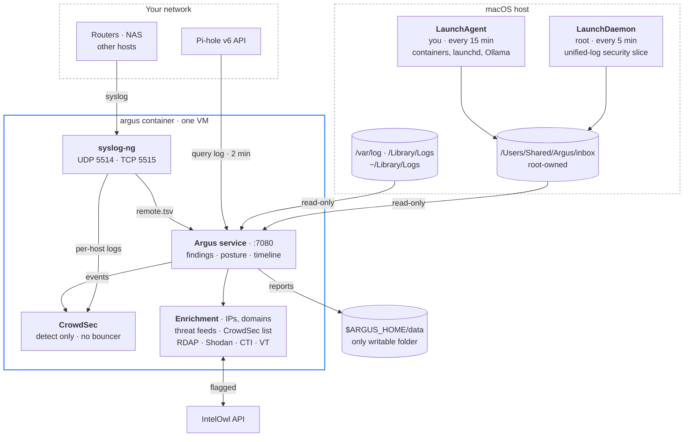

# Argus
Argus is a local log-analysis container for Macs running Apple's `container` runtime. Claude acted as the development agent, with human analysis driving the need. It reads the Mac's own logs (read-only), can take syslog from other devices on your network, and checks everything it collects against CrowdSec, a set of public threat feeds and OSINT lookups, including your own IntelOwl if you run one. The results show up in a dashboard at <http://127.0.0.1:7080>.

Argus only watches. It doesn't install a bouncer, and it never blocks anything on the Mac.

## How it fits together



### Why there's a host collector

macOS keeps its unified log in a binary format that only Apple's own `log` tool can read, so a Linux container can't open it directly. Instead, a small root job on the Mac runs `log show` every five minutes over back-to-back `--start`/`--end` windows and drops a filtered slice into an inbox. Nothing gets missed or counted twice between runs. Everything else (crash reports, `/var/log`, `~/Library/Logs`) is mounted into the container read-only.

## What the container can and can't touch

| Access | Paths |
|---|---|
| Read-only | collector inbox, `/private/var/log`, `/Library/Logs`, `~/Library/Logs` |
| Read-write on the Mac | `$ARGUS_HOME/data` only (reports, CSV exports, optional `config/feeds.json`) |
| Its own storage | named volumes `argus-state`, `argus-cs-config`, `argus-cs-data` (inside the VM, not on your file system) |
| Root file system | read-only (`ARGUS_READONLY_ROOT=1`), with tmpfs for `/tmp`, `/run` and `/var/log` |
| Network in | dashboard on `127.0.0.1:7080`; syslog on `127.0.0.1` unless you pick a LAN address |
| Capabilities | `NET_RAW`, `MKNOD`, `SYS_CHROOT`, `AUDIT_WRITE` and `SETFCAP` are dropped |

The collector is installed at `/usr/local/libexec/argus/` and owned by root. That's on purpose: a LaunchDaemon running as root should never execute a script your own account can edit.

## Prerequisites

- A Mac with [Apple's `container` CLI](https://github.com/apple/container) installed and working (`container --version` should print a version).
- Admin rights, because the host collector installs a root LaunchDaemon.

That's all you need to get started. Pi-hole, IntelOwl, CrowdSec enrollment and the OSINT keys are optional, and each stays off until you configure it.

## Setup

```bash
git clone https://github.com/rgregory/argus.git && cd argus
./argus.sh init                 # creates $ARGUS_HOME (default ~/.argus), config, CrowdSec bouncer key
# edit $ARGUS_HOME/config/argus.env (Pi-hole app password, IntelOwl token, optional keys; see argus.env.example)
./argus.sh build                # builds argus:latest (CrowdSec Alpine image + Node 24 + syslog-ng)
./argus.sh install-collector    # sudo: LaunchDaemon + your LaunchAgent, root-owned inbox
./argus.sh up                   # starts the container and prints the dashboard URL
```

Then open <http://127.0.0.1:7080>. Everything after this point is optional, and Argus runs fine with none of it set.

`$ARGUS_HOME` defaults to `~/.argus` and holds your config and reports. You can point it somewhere else. `init` sets the config file to `chmod 600` because it holds your API keys and passwords.

If you do move `ARGUS_HOME`, keep the path lowercase. The default Mac file system is case-insensitive, so a path like `~/Stuff/Argus` can quietly land in the same folder as another one, and you end up editing an `argus.env` that isn't the one being read. The default path is already lowercase, but nothing checks a custom one for you.

The paths in the rest of this README (`$ARGUS_HOME`, `/Users/Shared/Argus/inbox` and so on) are just the defaults from `argus.env.example`. Each one is a setting, so change whatever doesn't fit your layout in `argus.env`.

### Pi-hole

Leave `PIHOLE_URL` blank and `argus.sh up` looks for a running container with `pihole` in its name on the default network. Set `PIHOLE_PASSWORD` to an app password from Pi-hole's Settings → Web interface / API.

### IntelOwl

Apple `container` networks are isolated from each other, so Argus can only reach IntelOwl when both are on the same named network. Put IntelOwl's containers on the network Argus uses (`default`, unless you've changed it), find `intelowl-nginx`'s address with `container inspect intelowl-nginx`, and set `INTELOWL_URL` to it. Then paste an API token into `INTELOWL_TOKEN`. If `INTELOWL_URL` is blank, IntelOwl enrichment stays off.

Flagged indicators run the `FREE_TO_USE_ANALYZERS` playbook, up to 50 a day, and each job links back to `http://localhost:7001`.

### Syslog from other devices

Set `ARGUS_SYSLOG_BIND` to the Mac's LAN IP, run `./argus.sh restart`, and point your devices at `<mac-ip>:5514/udp` or `:5515/tcp`. Argus expects RFC 3164 (BSD) format, one message per line. `./argus.sh syslog-test` sends a test line so you can check it arrives.

### Send this Mac's own logs as syslog

```bash
./argus.sh stream on      # stream off | stream status
```

This turns on two feeds:

1. A live copy of the unified log. A root LaunchDaemon (`com.argus.logstream`) runs `log stream`, rewrites each line as RFC 3164 syslog and sends it over TCP to the listener, so CrowdSec sees SSH and sudo failures within seconds instead of waiting for the next five-minute batch. The default, `ARGUS_STREAM_MODE=slice`, sends only the security events. `all` sends the whole default-level log, which runs to hundreds of events a second, so save it for short investigations.
2. Legacy syslogd. It appends `*.* @127.0.0.1:5514` to `/etc/syslog.conf` (keeping a backup) and reloads `syslogd`. On current macOS that only covers the small stream you see in `/var/log/system.log` and `install.log`. Everything else goes to the unified log, which the first feed already handles.

`stream on` also sets `ARGUS_MACOS_TO_CROWDSEC=0` and restarts Argus so CrowdSec doesn't count the same event twice. The five-minute collector keeps running and still feeds the dashboard's macOS views. `stream off` puts everything back the way it was.

### Day to day

```bash
./argus.sh status | logs | shell | open
./argus.sh cscli alerts list    # anything cscli can do
./argus.sh restart              # after editing argus.env
./argus.sh destroy              # remove container + volumes, keep config and reports
```

## Threat intelligence

Every public IP address and domain Argus comes across becomes an indicator. They come from active connections, Pi-hole queries, SSH, Screen Sharing and firewall events, syslog messages, and anything you look up by hand. Argus checks each one against the feeds and CrowdSec straight away. The OSINT providers are slower and rate-limited, so they work through a priority queue:

| Priority | Indicators | Automatic enrichment |
|---|---|---|
| 3 | feed hits, CrowdSec matches, anything already flagged, manual lookups | every provider, including VirusTotal, CrowdSec CTI and IntelOwl |
| 2 | SSH, Screen Sharing and firewall sources; DNS names that look generated or tunnelled | the level 1 providers plus DNS resolution and ThreatFox |
| 1 | public IPs in active connections, IPs in syslog | Shodan InternetDB, AbuseIPDB, OTX, URLhaus, GreyNoise |
| 0 | every other domain Pi-hole sees | RDAP registration date (newly registered domains get flagged) |

| Feed | Key | Notes |
|---|---|---|
| HaGeZi Threat Intelligence (medium) | none | about 885k malware, phishing and C2 domains, matched on parent domains too |
| FireHOL Level 1, IPsum (3+ lists) | none | pulled from GitHub |
| Spamhaus DROP, Emerging Threats, CINS, blocklist.de, OpenPhish | none | |
| abuse.ch Feodo, URLhaus, ThreatFox | free Auth-Key | abuse.ch now requires a key; get one at auth.abuse.ch |
| CrowdSec community blocklist | none | read from the local API with the `argus` bouncer key |

The optional keys go in `argus.env`: `ABUSECH_AUTH_KEY`, `CROWDSEC_CTI_KEY`, `ABUSEIPDB_KEY`, `VT_API_KEY`, `OTX_API_KEY` and `GREYNOISE_KEY`. A provider without a key stays off, and daily caps keep you inside the free tiers. You can add your own feeds in `$ARGUS_HOME/data/config/feeds.json`:

```json
[{"id": "my_list", "name": "My blocklist", "kind": "domain", "format": "wildcard", "severity": "high",
  "url": "https://example.org/list.txt", "ttlHours": 12}]
```

Supported formats are `plain` (IPs, CIDRs or domains, one per line), `wildcard` (domains that also match their subdomains), `url` (full URLs, matched on the exact host), `ipsum` and `spamhaus-json`.

## What the macOS analysis covers

| Area | What Argus looks at |
|---|---|
| Access | sudo commands and failures, with risky ones flagged (removing quarantine, adding Gatekeeper exceptions, creating admin users); SSH and Screen Sharing logins; failed admin prompts; login history; screen lock and unlock |
| Permissions | apps holding Full Disk Access, Accessibility, Screen Recording, Input Monitoring, camera or microphone, taken from TCC decisions |
| Gatekeeper and XProtect | blocked launches, first-launch prompts for unsigned apps, XProtect detections |
| Persistence | launch agents and daemons, flagged when something looks off (temp or hidden paths, `curl` piped into `sh`, fake `com.apple` labels, world-writable plists); background items with no Team ID; system extensions, profiles, crontab and agents that keep failing |
| Network | services listening beyond localhost, and the public endpoints the Mac is talking to |
| Posture | SIP, Gatekeeper, FileVault, firewall and stealth mode, Remote Login, automatic updates, and how old the XProtect definitions are |
| System | crash and panic reports, memory-pressure kills, processes logging lots of faults, sleep and wake, install history, Apple container log errors, and whether the Ollama API is exposed |

Every five minutes Argus writes reports to `$ARGUS_HOME/data/reports/`: `latest.json`, `findings.csv`, `indicators.csv`, and one JSON file per day.

## Log throughput

A Mac playing YouTube in Safari writes hundreds of unified-log entries per second. Argus only ships the security slice, which is usually well under one event per second.

| Stream | Typical rate | Volume per day |
|---|---|---|
| Full unified log, default level, Safari + YouTube (estimate) | about 100 to 500 events/s, with bursts in the thousands | about 6 to 43 GB as ndjson (0.65 to 1 KB per event), or 1.5 to 9 GB as compact text |
| Same, with `--info` | several times higher | not worth shipping |
| Argus security slice (auth, sudo, SSH, TCC, Gatekeeper, XProtect, firewall, login items, faults) | about 0.05 to 1 events/s | about 3 to 55 MB as ndjson; the CrowdSec copy is roughly a sixth of that |
| Pi-hole queries during a YouTube session | a few hundred an hour | under 1 MB |
| Home router syslog with firewall logging on | 1 to 20 messages/s | about 10 to 250 MB |

These are estimates, but they're anchored on published measurements. Howard Oakley counted about 6,100 entries per second written to disk during a short burst of activity, plus about 1,700 per second held only in memory. The on-disk Persist store tops out around 525 MB, which on a busy Mac covers anything from under 12 hours to about five days. Video playback keeps WebKit's GPU and media processes, CoreMedia, coreaudiod, the network stack and WindowServer busy, but nearly everything they log is info and debug chatter with no security value. That's why Argus filters on the Mac instead of shipping everything.

To measure your own Mac, start a video and run these. Each one reads the last 10 minutes:

```bash
log show --last 10m --style ndjson | wc -lc                       # full default level
log show --last 10m --info --style ndjson | wc -lc                # with info
sudo /usr/local/libexec/argus/argus-collect.sh system && \
  wc -lc /Users/Shared/Argus/inbox/unified/*/* | tail -1          # Argus slice so far
```

Divide the line count by 600 to get events per second. The dashboard's Throughput tab shows live rates for each input and a projected daily volume. CrowdSec handles thousands of lines a second, so at these rates it's never the bottleneck.

## Known limits

- CrowdSec takes a minute to start. Before its Local API starts listening, the bundled daemon runs a hub update and registers with CAPI, so right after `argus.sh up` or `restart` the dashboard's CrowdSec tab can briefly show `connect: connection refused`. It clears up on its own within a poll cycle or two. If it doesn't, `argus.sh logs | grep -iE 'crowdsec|capi|hub update'` shows where it's stuck.
- `argus.env` is plain `KEY=value` lines, not a shell script. `argus.sh` strips one pair of wrapping quotes from a value, but everything else is taken literally, including a `# comment` after the value. Keep comments on their own lines.
- Apple's documentation only shows ports published on loopback. If the runtime refuses to bind the syslog port to your LAN IP, keep `127.0.0.1` and relay syslog through another host.
- The build can fail on DNS. If `container build` stops with `DNS: transient error`, or apk reports "no such package", the builder VM can't resolve names. That happens a lot when the Mac uses a local Pi-hole for DNS. `./argus.sh build` notices, recreates the builder with `ARGUS_BUILD_DNS` (default `1.1.1.1 9.9.9.9`) and tries again, and `./argus.sh builder-reset` does just the reset. If feeds fail to download at runtime for the same reason, set `ARGUS_DNS`.
- The root file system is read-only. If CrowdSec's start script tries to write somewhere unexpected, set `ARGUS_READONLY_ROOT=0` and run `./argus.sh restart`.
- CrowdSec ignores private IP addresses by default, so brute force from a local network (café Wi-Fi, say) won't raise a CrowdSec alert. Argus's own SSH and Screen Sharing findings still flag it.
- Crash reports and logs that only root can read reach the container through the collector, not through the read-only mounts.
- You only need `./argus.sh host-access` (which sets up `host.container.internal`) for services published on the Mac's `127.0.0.1`. It turns off iCloud Private Relay and doesn't survive a reboot.

## Security

[SECURITY.md](SECURITY.md) covers the trust model: what the container can and can't touch, which indicator data leaves the Mac and which providers receive it, how secrets are handled, and notes on the supply chain. `sbom.json` is a CycloneDX bill of materials for the npm dependencies, Docker base images, Alpine packages and the dashboard libraries loaded from a CDN. [docs/sbom.md](docs/sbom.md) has the same information in plain Markdown.

## Layout

**Top level**

| File | Purpose |
|---|---|
| `argus.sh` | The manager: build, up/down, collector install |
| `argus.env.example` | Settings template |
| `SECURITY.md` | Trust model, data flows, secrets, supply chain |
| `sbom.json` | CycloneDX software bill of materials |
| `docs/` | `sbom.md` (a readable SBOM) and `README.html` (an HTML copy of this README) |

**Host collector (`collector/`)**

| File | Purpose |
|---|---|
| `argus-collect.sh` | Exports the unified-log slice and host state (system, user or once) |
| `argus-logstream.sh` | Live unified-log to syslog relay, started by `argus.sh stream on` |

**Container image (`image/`)**

| File | Purpose |
|---|---|
| `Dockerfile` | CrowdSec (Alpine) + Node 24 + syslog-ng |
| `entrypoint.sh` | Supervises syslog-ng, CrowdSec and Argus |
| `syslog-ng.conf` | UDP 5514 / TCP 5515 into CrowdSec's files and the Argus spool |
| `acquis-argus.yaml` | CrowdSec acquisition config |

**Service (`app/`)**

| File | Purpose |
|---|---|
| `server.js` | HTTP service and API |
| `lib/engine.js` | macOS log analyzer (it also runs in a browser) |
| `lib/intel.js` | Indicators, scoring, OSINT providers |
| `lib/feeds.js` | Threat feeds |
| `lib/crowdsec.js` | Decisions stream and alerts |
| `lib/ingest.js` | Inbox, syslog spool, Pi-hole |
| `lib/store.js` | SQLite state (`node:sqlite`) |
| `lib/throughput.js` | Event and byte counters for each input |
| `lib/util.js` | Config from the environment, plus shared helpers |
| `public/index.html` | The dashboard (Tabler, Alpine.js, Chart.js, PapaParse) |

## References

- Apple `container`: [command reference](https://github.com/apple/container/blob/main/docs/command-reference.md), [networking](https://github.com/apple/container/blob/main/docs/networking.md), [volumes](https://github.com/apple/container/blob/main/docs/volumes.md), [host integration](https://github.com/apple/container/blob/main/docs/host-integration.md)
- [CrowdSec Docker image](https://hub.docker.com/r/crowdsecurity/crowdsec)
- [Pi-hole FTL API spec](https://github.com/pi-hole/FTL/tree/master/src/api/docs/content/specs)
- [pyintelowl (IntelOwl API)](https://pypi.org/project/pyintelowl/)
- [abuse.ch ThreatFox export / Auth-Key](https://threatfox.abuse.ch/export/)
- Howard Oakley: [Inside the Unified Log 3: log storage and attrition](https://eclecticlight.co/2025/09/29/inside-the-unified-log-3-log-storage-and-attrition/), [How long does the log keep entries?](https://eclecticlight.co/2026/03/12/how-long-does-the-log-keep-entries/)
